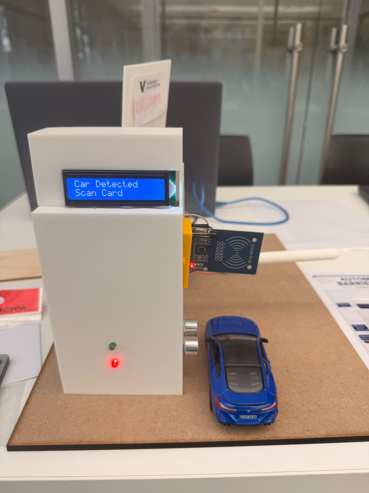
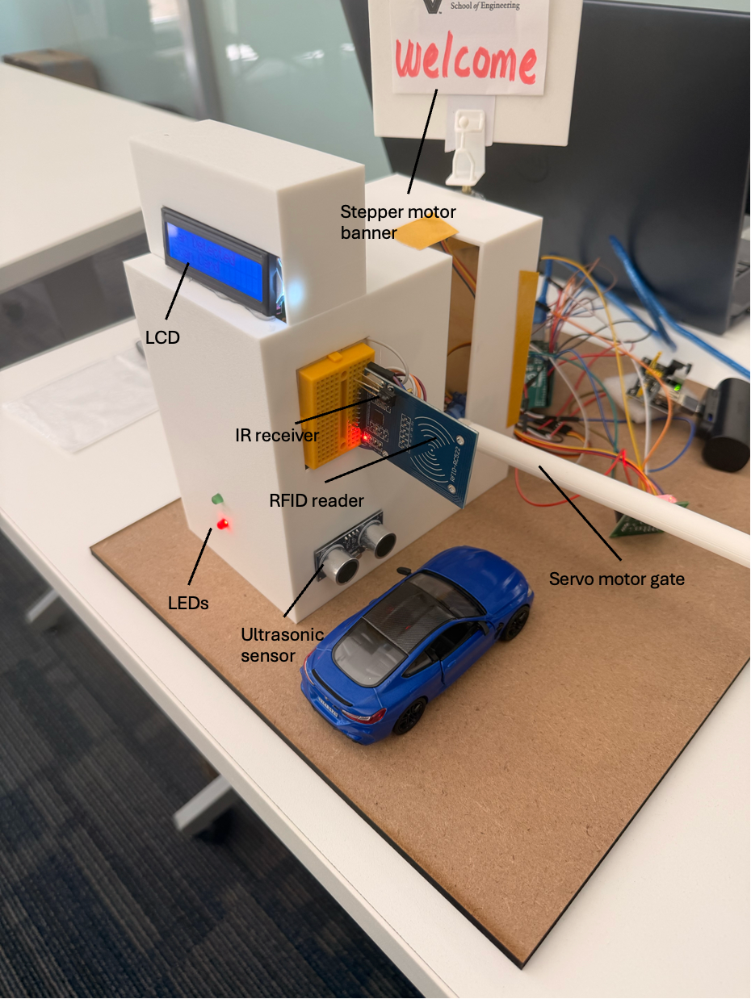
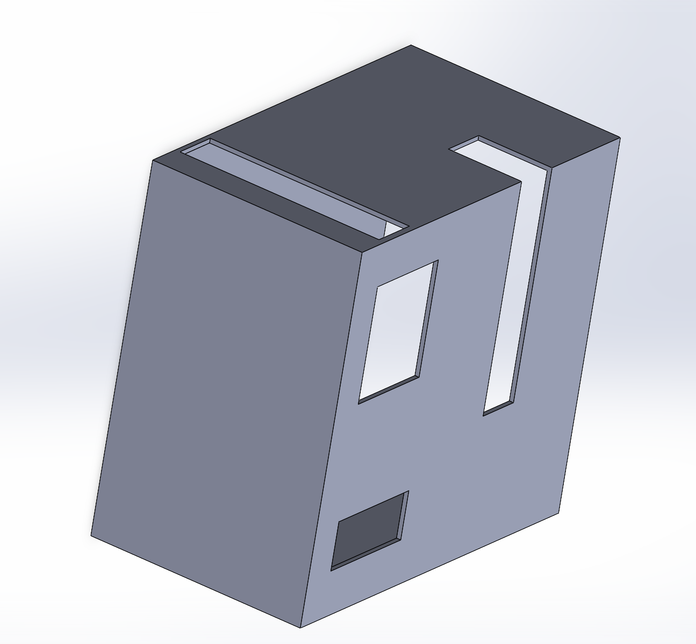
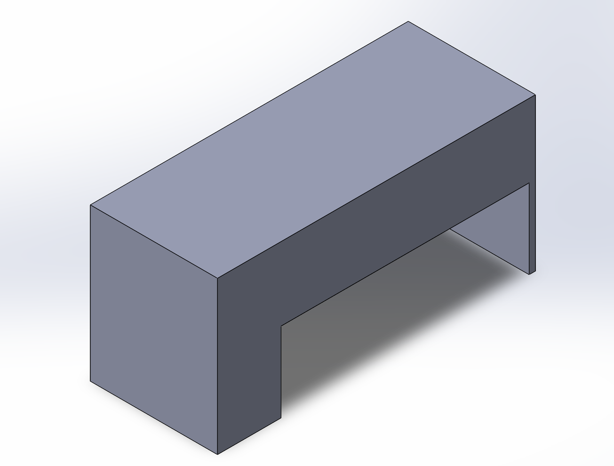
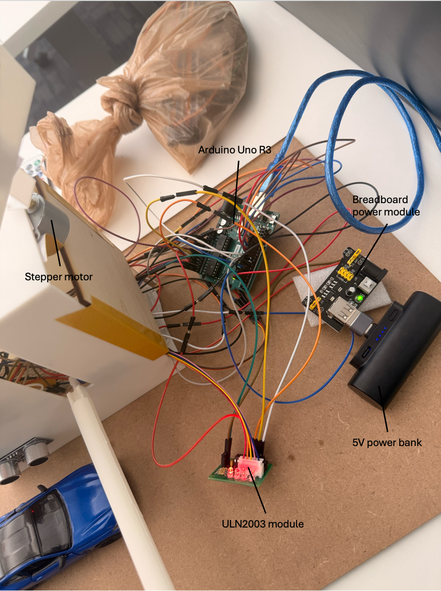

# Automated Smart Barrier Gate System

**Arduino-based vehicle detection and RFID access-control prototype**  
Mechatronics Design Project (ME 3204)

## Watch the prototype in action

https://github.com/user-attachments/assets/7fcebe2e-2c9f-486f-bf1e-2c16675b90ef

**[Watch the demonstration video (MP4)](media/video/system_demo.mp4)** — shows the working prototype, vehicle interaction, LCD feedback, and gate operation. Click the preview to open the video in GitHub.

An integrated mechatronics prototype of a controlled-entry parking barrier. An Arduino Uno detects an approaching vehicle using an ultrasonic sensor, prompts for an RFID card, and checks its UID against a configured allowlist. On authorization, a servo raises the gate arm; an LCD, status LEDs, and a passive buzzer provide feedback. An IR remote supports manual override, while a stepper-driven banner moves independently of the gate sequence.

> **Prototype, not a production security or vehicle-safety system.** RFID UID matching can be spoofed, and the gate closes on a programmed timing sequence; it does not guarantee the vehicle has cleared the barrier.

## What it does

1. Detects a vehicle using an HC-SR04 ultrasonic sensor (configured threshold: **15 cm**).
2. Displays **Car Detected / Scan Card** on a 16×2 LCD.
3. Reads an RC522 RFID card UID and compares it against an allowlist.
4. Grants or denies access; on a grant, a servo opens the barrier and LEDs/buzzer provide feedback.
5. After the initial **4-second** open period, checks vehicle presence. If a vehicle remains, displays **Please Proceed** and waits another **3 seconds** before closing; otherwise closes after the initial period.
6. Allows an IR remote to trigger a manual opening sequence.
7. Sweeps a top-mounted banner back and forth through approximately **180°**, using a 28BYJ-48 stepper motor and ULN2003 driver. Banner updates also occur during the program's custom waits.

## Hardware

- Arduino Uno R3
- MFRC522 / RC522 RFID reader, card and tag
- HC-SR04 ultrasonic distance sensor
- 16×2 I2C LCD
- Servo motor and barrier arm
- IR receiver and remote
- 28BYJ-48 stepper motor with ULN2003 driver
- Red/green LEDs, passive buzzer
- 5 V power bank and breadboard power module for stepper motor supply
- 3D-printed enclosure designed in SolidWorks

### Arduino wiring

| Component                             | Pin(s)            |
| ------------------------------------- | ----------------- |
| Red LED / green LED                   | D2 / D4           |
| Passive buzzer                        | D3                |
| Servo signal                          | D5                |
| Ultrasonic trigger / echo             | D6 / D7           |
| Stepper ULN2003 IN1 / IN2 / IN3 / IN4 | D8 / A1 / A2 / A3 |
| RFID RST / SS                         | D9 / D10          |
| RFID MOSI / MISO / SCK                | D11 / D12 / D13   |
| IR receiver                           | A0                |
| I2C LCD SDA / SCL                     | A4 / A5           |

See [full project report](docs/technical_report.pdf) for the parts list, build procedure, and detailed pin table.

**Power note:** The final prototype used a separate 5 V power bank for the stepper subsystem, with its ground connected to Arduino ground. The report describes RFID supply-voltage troubleshooting; that experimental resistor-divider arrangement **should not be copied as a recommended power design**. Follow the module's rated supply specification (typically 3.3 V for RC522) and use a suitable regulated power source/level shifting as needed.

## Firmware and setup

Main sketch: [`firmware/smart_barrier_gate/smart_barrier_gate.ino`](firmware/smart_barrier_gate/smart_barrier_gate.ino)

1. Open the main sketch in the Arduino IDE and select an **Arduino Uno**.
2. Install the compatible libraries used by the code: `MFRC522`, `LiquidCrystal_I2C`, and `IRremote`. The sketch also uses `SPI`, `Wire`, `Servo`, and `Stepper` from the Arduino ecosystem. Library API/version compatibility may need checking.
3. Use [`firmware/tests/rfid_test/`](firmware/tests/rfid_test/) to read the UID of your own test card. **Replace the placeholder UID** in `allowedCards` in the main sketch. The standalone RFID test uses a different RST pin (D7) than the integrated sketch (D9); wire it accordingly.
4. Use [`firmware/tests/remote_test/`](firmware/tests/remote_test/) to identify your remote control command; update `REMOTE_OVERRIDE_CMD` if it differs from `0x44`.
5. Verify wiring, power supplies, and shared ground; adjust the LCD I2C address, servo angles, and car detection threshold for your physical setup.
6. Upload the integrated sketch and test one subsystem at a time before operating the assembled prototype.

> The prototype was built and tested on physical hardware. The published firmware includes a sample RFID UID that must be replaced with an authorized card's UID before use. The published code has not been independently recompiled or retested since preparation for GitHub.

## CAD and fabrication

Native SolidWorks part models: [`hardware/solidworks/`](hardware/solidworks/)

| Main enclosure                                  | Upper support                                     |
| ----------------------------------------------- | ------------------------------------------------- |
|  |  |

The housing was 3D printed. LED holes were added after fabrication because they were missing from the initial CAD model. Only individual `.SLDPRT` parts are available here; no complete SolidWorks assembly or STL export is included.

## Engineering challenges and lessons

- **RFID reliability during integration:** The reader initially worked in isolation but became inconsistent when connected alongside the other components. The build required troubleshooting electrical supply behavior rather than only changing software.
- **Power distribution:** Driving multiple loads from the Arduino supply caused jerky actuator motion. A separate 5 V source for the stepper subsystem, sharing ground with the Arduino, improved stability.
- **Coordinating motion and feedback:** A custom `smartDelay()` routine continues advancing the stepper during delay periods while the gate sequence runs, although the sketch still contains blocking operations.
- **Practical mechanical integration:** Designed a printed housing that accommodates the display, sensors, RFID reader and gate drive while leaving access for rear wiring.

## Project documentation and gallery

- [Complete 22-page report](docs/technical_report.pdf) — build procedure, hardware, pinout, testing notes, and lessons learned
- [Project poster](docs/project_poster.jpeg)
- [Annotated electronics and power layout](media/photos/annotated_electronics_view.png)
- [Top view of assembled system](media/photos/top_view.jpg)

## Notes on safety and scope

This is a teaching/demonstration prototype. The system uses UID matching for access control, timing for gate closure, and a tested experimental circuit arrangement. A real entry system would need stronger authentication, regulated power, obstacle/clearance interlocks, and appropriate electrical and mechanical safety measures.
